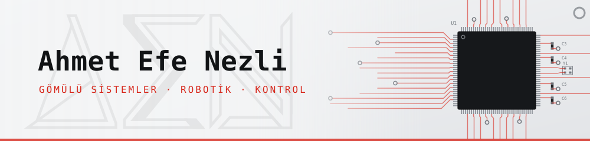

<picture>
  <source media="(prefers-color-scheme: dark)" srcset="https://raw.githubusercontent.com/dwifk0/dwifk0/main/varlik/banner-koyu.svg">
  
</picture>

Manisa Celâl Bayar Üniversitesi Elektrik-Elektronik Mühendisliği lisans
öğrencisiyim. Çalışmalarım gömülü sistemlerin **kart seviyesinde** yoğunlaşıyor:
gerçek zamanlı kontrol, emniyet mimarisi ve sensör entegrasyonu.

İki TEKNOFEST takımında gömülü sistemler ve donanım sorumluluğunu yürütüyorum —
bir otonom kara aracı ve bir hava savunma taret sistemi. Öncesinde dört yıl FLL
ve FRC.

---

## Neler yaptım

### 🚜 LYDİA — Otonom Kara Aracı · TEKNOFEST 2026 **finalist**
**MCBÜ MAGNESIA** · Gömülü Sistemler ve Donanım Entegrasyon Sorumlusu

48 V'luk aracın **bütün sürüş ve sensör yazılımını tek bir STM32F767ZI'de**
topladım: kumanda, gaz, fren, direksiyon, geri vites, güç kesme. Jetson Orin
Nano ile arasındaki seri köprüyü, ROS 2 arayüzünü, manuel/otonom kip hakemini
ve donanım acil stop zincirini kurdum. Enkoder ve IMU verisinden odometri
üreterek otonom kipte daha kararlı bir ilerleme sağladım.

*Araç, Eylül 2026'da Mardin'de düzenlenen finale **finalist olarak** katıldı.*

### 🛡️ MİĞFER — Hava Savunma Taret Sistemi · TEKNOFEST Çelikkubbe
**MCBÜ SAVSİSTEK** · Gömülü Sistemler ve Yapay Görü Sorumlusu
→ **[`hss26-gomulu-public`](https://github.com/dwifk0/hss26-gomulu-public)**

ESP32-S3 ana firmware'i: 50 kHz kesme içinde **DDS adım üreteciyle** pan-tilt
hareketi, yasak alan kilidi, kopuk kabloyu "basılı" okuyan mandallı acil stop
zinciri, güç tüketimi izleme. Raspberry Pi 5 ve Hailo-8L NPU üzerinde çalışan
gerçek zamanlı tespit hattını kurdum. PyQt6 yer kontrol arayüzüyle taret
arasındaki TCP köprüsünü, Kalman filtreli hedef takibini ve atış karar mantığını
geliştirdim. Sistem, açılışta kendiliğinden ayağa kalkan üç systemd servisine
bağlı olarak çalışıyor.

### 🤖 BALROB — FIRST Robotics Competition
**Elektronik-Gömülü Sistemler Sorumlusu** · 2020–2024

Takımın elektronik altyapısını ve gömülü süreçlerini yönettim; RoboRIO
entegrasyonu ve görev programlaması (C++ / Java), otonom kontrol algoritmaları.

---

## Çalıştığım katmanlar

```
uygulama    ROS 2 (Humble / Jazzy) · Nav2 · SLAM · EKF sensör füzyonu · Gazebo
            Ackermann kinematiği · PyQt6 · web tabanlı operatör panoları
yapay görü  YOLOv8 · OpenCV · Hailo NPU (Dataflow Compiler) · Kalman filtresi
sistem      Ubuntu Linux · systemd · Docker · udev · DKMS
            Jetson Orin Nano · Raspberry Pi 5
firmware    STM32 (Nucleo-F767ZI, PlatformIO) · ESP32 / ESP32-S3 · Arduino
            RoboRIO · kesme içinde gerçek zamanlı iş
veriyolu    CAN · UART · I²C · SPI · RS485 / Modbus · PWM · iBUS · USB CDC
donanım     step sürücü · BLDC · röle mantığı · şönt akım ölçümü · BMS
            E-stop mimarisi · KiCAD · EasyEDA · Fritzing · Fusion 360
dil         C · C++ · Python · Java · MATLAB
öğreniyorum FPGA (Verilog / VHDL) · güvenli bootloader · FOC motor sürücü tasarımı
```

## Mühendislik yaklaşımım

**Doğrulanabilirlik.** Tasarım kararlarını ölçüme dayandırırım; paylaştığım her
değer ya ölçülmüştür ya da nasıl ölçüldüğü belgesinde yer alır. Varsayımla
ilerleyen bir tasarımın bedeli sahada ödenir.

**Emniyet, sonradan eklenen bir katman değildir.** Kritik kesme yollarını
yazılımdan bağımsız kurgular, arıza durumunda sistemin güvenli tarafa düşmesini
varsayılan davranış hâline getiririm.

**İzlenebilir dokümantasyon.** Devreye alma süreçlerini, ölçümleri ve karar
gerekçelerini yazılı tutarım; bir sistemin sürdürülebilirliği onu kuran kişiye
bağımlı olmamalıdır.

**Anlaşılırlık.** Teslim ettiğim kodun her satırının nasıl çalıştığını
açıklayabilir olmayı çalışma şartı sayarım.

## İletişim

[](https://www.linkedin.com/in/ahmet-efe-nezli)
[](mailto:ahmetefenezli@gmail.com)

<sub>Depolarımın bir kısmı aktif yarışma çalışması olduğu için kapalı. Açık
olanlar, üzerinde durabileceğim işlerdir.</sub>
